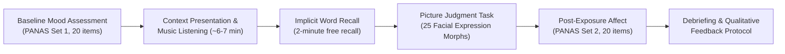
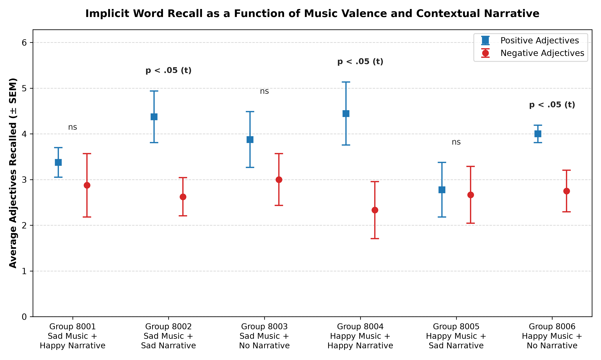
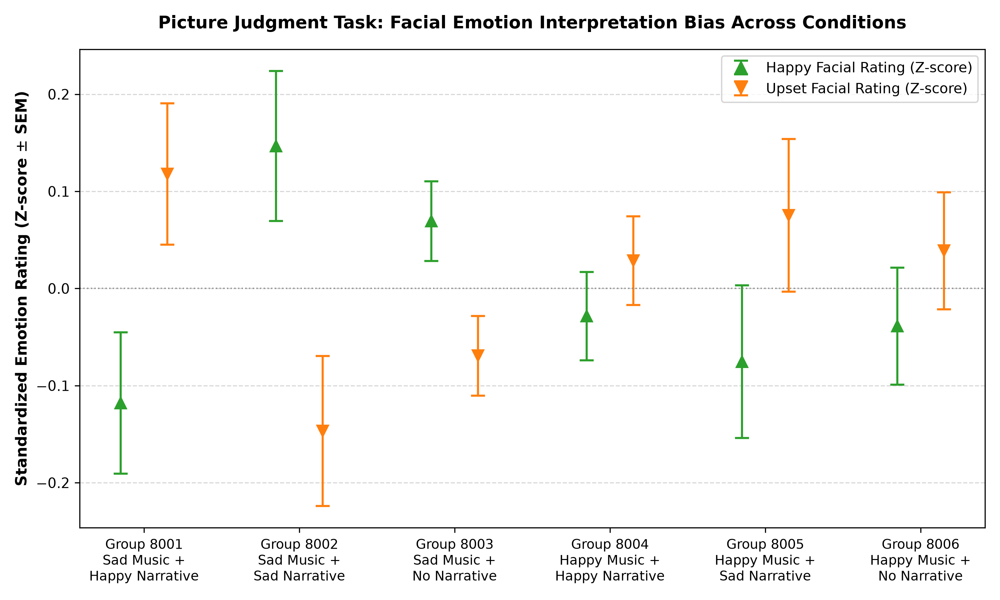
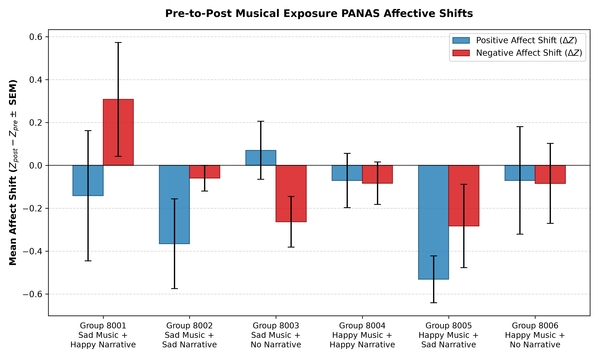

# Enhancing Music-Induced Emotions: The Role of Extramusical Contextual Narratives

> **An empirical cognitive psychology and psychometrics study investigating how contextual narratives (emotionally congruent, incongruent, or absent) modulate explicit and implicit emotional experiences induced by musical excerpts.**

Conducted as part of the **Music, Mind, and Theory (MMT)** curriculum by **Abhiram Tilak** and **Niranjan Nagumalli**.

---

## Executive Summary & Key Discoveries

Can the story you read right before listening to music alter how you feel, remember, and interpret emotional cues? 

Building on foundational work by **Vuoskoski & Eerola (2012, 2013)**, this project expands empirical understanding by testing both **Sad** and **Happy** musical excerpts against **Congruent**, **Incongruent**, and **Control (No Narrative)** conditions across 50 tested subjects ($N=50$) in a rigorous $2 \times 3$ factorial between-subjects experimental design.

```
                    ┌────────────────────────────────────────────────────────┐
                    │               EXPERIMENTAL 2x3 FACTORIAL MATRIX        │
                    └────────────────────────────────────────────────────────┘
                                            Musical Stimulus
                                     Sad Music            Happy Music
                            ┌────────────────────────┬────────────────────────┐
          Happy Narrative   │ Group 1 (Incongruent)  │ Group 4 (Congruent)    │
  Context                   ├────────────────────────┼────────────────────────┤
 Narrative  Sad Narrative   │ Group 2 (Congruent)    │ Group 5 (Incongruent)  │
                            ├────────────────────────┼────────────────────────┤
          No Narrative      │ Group 3 (Control)      │ Group 6 (Control)      │
                            └────────────────────────┴────────────────────────┘
```

###  Key Findings:
1. **Cognitive Incongruence Eliminates Mood-Congruent Memory Bias**:
   - Under congruent conditions (Group 2: Sad Music + Sad Story, $p = 0.0349$; Group 4: Happy Music + Happy Story, $p = 0.0035$) and neutral music baseline (Group 6, $p = 0.0141$), participants exhibited a significant positive word recall bias.
   - When narrative and musical cues conflicted (Group 1: Sad Music + Happy Story, $p = 0.2708$; Group 5: Happy Music + Sad Story, $p = 0.4326$), this bias was completely neutralized by cognitive interference.
2. **Tragic Narratives Overpower Happy Auditory Affect**:
   - In Group 5 (Happy Music paired with a somber narrative of war displacement), self-reported positive affect collapsed precipitously from pre-to-post exposure ($\Delta Z = -0.5315, t = 4.8586, \mathbf{p = 0.0013}$). Semantic narrative context exerted top-down emotional suppression strong enough to invert auditory valence.
3. **Implicit Facial Emotion Interpretation Shift**:
   - Standardized facial ratings on 25 prototypical facial morphs revealed marginal trend-level differences across conditions ($F(5, 44) = 2.243, p = 0.0666$), demonstrating subtle implicit priming of social perception.

---

##  Experimental Methodology & Stimuli



### 1. Factorial Groups
- **Group 8001 (Incongruent)**: Sad Music Excerpt + Joyful *Little Michael* narrative (birth of three female lambs).
- **Group 8002 (Congruent)**: Sad Music Excerpt + Somber *Old Man at the Bridge* narrative (Hemingway; civilian displaced by artillery shelling).
- **Group 8003 (Control)**: Sad Music Excerpt with no narrative.
- **Group 8004 (Congruent)**: Happy Music Excerpt + Joyful *Little Michael* narrative.
- **Group 8005 (Incongruent)**: Happy Music Excerpt + Somber *Old Man at the Bridge* narrative.
- **Group 8006 (Control)**: Happy Music Excerpt with no narrative.

### 2. Measurement Instruments
- **PANAS (Positive and Negative Affect Schedule)**: 20 mood adjectives (10 Positive Affect, 10 Negative Affect) rated on a 5-point Likert scale, administered before ($t_0$) and after ($t_1$) musical exposure to compute within-subject affective trajectory ($\Delta Z$).
- **Indirect Word Recall Task**: 2-minute memory test measuring implicit mood congruence through selective recall of positive vs. negative adjectives.
- **Picture Judgment Task**: 25 composite computer-morphed facial expressions (Vanger, Hoenlinger, & Haken, 1998) rated on 7-point Likert scales for Happy and Upset dimensions, standardized into within-subject ipsatized z-scores.

---

##  Visualizations & Statistical Results

### 1. Word Recall Bias (Positive vs. Negative Adjectives)

*Error bar comparison of positive versus negative adjectives recalled per condition ($\pm$ SEM). Annotations denote paired within-group significance ($p < .05$).*

### 2. Picture Judgment Task (Facial Emotion Perception Bias)

*Standardized facial rating z-scores for Happy and Upset expressions across all 6 experimental groups.*

### 3. Subjective Affect Shifts (Pre-to-Post Musical Exposure)

*Mean within-subject affect changes ($Z_{post} - Z_{pre} \pm \text{SEM}$). Note the statistically significant drop in positive affect for Group 8005 ($p = 0.0013$).*

---

##  Repository Structure

```
.
├── README.md                          # Comprehensive project documentation
├── LICENSE                            # MIT Open Source License
├── pyproject.toml                     # Modern build and project configuration
├── requirements.txt                   # Reproducible Python dependencies
├── .gitignore                         # Git exclusion rules (virtual environments, cache)
│
├── data/
│   ├── README.md                      # Data dictionary and variable codebook
│   ├── raw/
│   │   ├── survey_responses_raw.txt   # Original unedited survey responses export
│   │   └── survey_responses_raw.xlsx  # Original spreadsheet survey dataset
│   └── processed/
│       └── experiment_data_clean.csv  # Cleaned experimental dataset (N=50)
│
├── docs/
│   ├── project_proposal.pdf           # Original research proposal & theoretical framework
│   ├── references.bib                 # BibTeX bibliography file
│   └── literature/
│       ├── Vuoskoski_Eerola_2012_Can_Sad_Music_Make_You_Sad.pdf
│       └── Vuoskoski_Eerola_2013_Extramusical_Information.pdf
│
├── experiment/                        # Psychological stimuli presentation portal
│   ├── README.md                      # Stimuli guide and multi-port server instructions
│   ├── index.html                     # Participant routing landing page
│   ├── serve.sh                       # Multi-port background HTTP server launcher
│   ├── audio/                         # Master audio stimulus files (sad.webm, happy.webm)
│   └── 1/ .. 6/                       # Condition-specific web pages (ports 8001–8006)
│
├── src/                               # Modular, clean, type-hinted Python research code
│   ├── __init__.py                    # Package initializer
│   ├── config.py                      # Adjective batteries, Likert mappings, group mappings
│   ├── word_recall_analysis.py        # Word recall hypothesis testing and plotting
│   ├── picture_judgment_analysis.py   # Facial expression z-scores, ANOVA, and plotting
│   ├── panas_affect_analysis.py       # Pre-vs-post PANAS paired tests and plotting
│   └── run_all.py                     # Master pipeline orchestrator
│
└── results/
    ├── analysis_report.md             # Complete statistical report with ANOVA & t-test tables
    └── figures/                       # Publication-grade figures (300 DPI)
        ├── word_recall_scores.png
        ├── facial_emotion_ratings.png
        └── panas_affect_shifts.png
```

---

## How to Reproduce results?

### 1. Installation
Clone the repository and set up a virtual environment:

```bash
# Clone the repository
git clone https://github.com/your-username/music-induced-emotions-narrative.git
cd music-induced-emotions-narrative

# Using uv (fastest)
uv venv .venv
source .venv/bin/activate
uv pip install -r requirements.txt

# Or using standard python venv
python3 -m venv .venv
source .venv/bin/activate
pip install -r requirements.txt
```

### 2. Execute Full Research Pipeline
Run all statistical analyses, regenerate high-resolution figures, and compile the consolidated analysis report:

```bash
python -m src.run_all
```

Outputs will be saved in:
- `results/figures/` (PNG plots)
- `results/analysis_report.md` (detailed Markdown report)

### 3. Run Individual Analyses
Each module supports CLI customization:

```bash
# Word Recall Task Analysis
python -m src.word_recall_analysis --data data/processed/experiment_data_clean.csv --output-dir results/figures

# Facial Emotion Ratings Analysis
python -m src.picture_judgment_analysis --data data/processed/experiment_data_clean.csv --output-dir results/figures

# PANAS Affective Shift Analysis
python -m src.panas_affect_analysis --data data/processed/experiment_data_clean.csv --output-dir results/figures
```

### 4. Launch the Web Experiment Interface
To inspect or run the experiment delivery environment locally:

```bash
./experiment/serve.sh
```
Open [http://localhost:8000](http://localhost:8000) to view the routing hub, or access individual condition ports from `8001` to `8006`.

